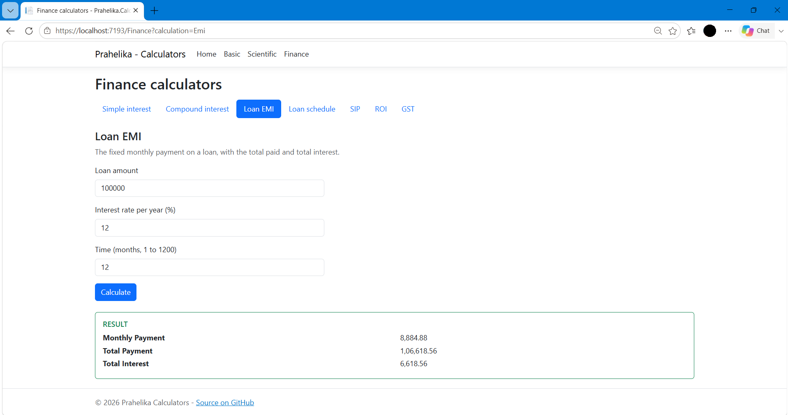

# Prahelika.Calculators

[](https://github.com/PD0704/Prahelika.Calculators/actions/workflows/ci.yml)

[](https://codecov.io/github/PD0704/Prahelika.Calculators)

[](https://www.nuget.org/packages/Prahelika.Calculators)
[](LICENSE)

A tested .NET calculator library with basic, scientific and finance calculators, plus a REST API and a simple website that use it.



## Live demo

Coming soon.

## What's inside

| Part | What it is |
|---|---|
| **Core library** (NuGet: `Prahelika.Calculators`) | The calculators. Results come back as a `CalcResult<T>` object instead of exceptions for bad input. |
| **API** (ASP.NET Core 10 Minimal API) | Every calculator as an endpoint, with Swagger documentation at `/swagger`. |
| **Web** (Razor Pages) | A simple website for the Basic, Scientific and Finance calculators. |
| **Tests** (xUnit) | Unit tests for the library and integration tests for the API and the web pages, run on every pull request. |

## Calculators

- **Basic:** add, subtract, multiply, divide, remainder and percentage, using exact `decimal` arithmetic.
- **Scientific:** power, roots, logarithms, trigonometry in degrees or radians, and factorial, using `double`.
- **Finance:** simple and compound interest, loan EMI and amortisation schedule, SIP, ROI and GST, with rounding to 2 decimal places.

## Use the library

```
dotnet add package Prahelika.Calculators --prerelease
```

```csharp
using Prahelika.Calculators.Core.Basic;

var calculator = new BasicCalculator();
var result = calculator.Divide(10m, 4m);

Console.WriteLine(result.IsSuccess ? result.Value : result.Message); // 2.5
```

More examples are on the [NuGet page](https://www.nuget.org/packages/Prahelika.Calculators).

## Run it locally

You need the [.NET 10 SDK](https://dotnet.microsoft.com/download).

```
git clone https://github.com/PD0704/Prahelika.Calculators.git
cd Prahelika.Calculators
dotnet run --project Prahelika.Calculators/src/Prahelika.Calculators.Web
```

To run the API with Swagger instead, use the `Prahelika.Calculators.Api` project in the same way and open `/swagger`.

To run all the tests:

```
dotnet test Prahelika.Calculators/Prahelika.Calculators.slnx
```

## API example

```
GET /api/scientific/sin?angle=90&unit=degrees
```

The response contains the result and the unit that was used. Errors use the standard problem-details format (RFC 9457), with an extra `code` field.

## Roadmap

- [x] Basic, scientific and finance calculators
- [x] REST API with Swagger
- [x] Website
- [x] Automated tests and CI with code coverage
- [x] Automatic NuGet publishing from version tags
- [ ] Live demo
- [ ] Version 1.0.0
- [ ] More calculators (ideas: unit converter, date and time, BMI)
- [ ] GST split into CGST and SGST

## Contributing

Contributions and ideas are welcome. Open an issue to start a conversation.

## Licence

MIT. See [LICENSE](LICENSE).